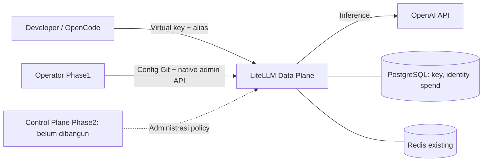

# Rancangan dan tujuan proyek

[Mulai di README](../README.md) · [Master aktif](../MASTER_CONTEXT.md).

## 1. Masalah yang ingin diselesaikan

Perusahaan membutuhkan cara memberi akses AI kepada developer tanpa menyebarkan
provider API key. Akses perlu dibatasi sesuai user/team, pemakaian/biaya perlu tercatat,
dan key dapat dicabut ketika tidak lagi dibutuhkan.

Gateway menyediakan endpoint yang kompatibel dengan OpenAI API. Client menggunakan
alias perusahaan sehingga pengaturan backend tetap di sisi platform. Penggantian
provider/model bukan keputusan otomatis: kontrak dan approval tetap berlaku.

## 2. Alur sistem

LiteLLM mengirim inference langsung ke provider; Redis bukan perantara ke OpenAI.
Saat ini Redis ada dan diperiksa sebagai dependency operasional. Kebutuhan distributed
cache/enforcement belum dibuktikan; perubahan perannya memerlukan keputusan.

| Istilah | Penjelasan sederhana |
|---|---|
| Data Plane | Bagian yang menerima dan menjalankan request AI; sekarang LiteLLM |
| Control Plane | Bagian yang mengatur siapa boleh mengakses apa; custom service baru Phase2 |
| Virtual key | Credential gateway milik pengguna/workload; bukan provider/master key |
| Logical alias | Nama `company-fast` / `company-coding` yang dipakai client |
| Desired state | Konfigurasi yang diinginkan; perlu dibedakan dari keadaan runtime aktual |
| ADR | Catatan keputusan arsitektur, status persetujuan dan konsekuensinya |
| Acceptance gate | Bukti/persetujuan minimum sebelum suatu fase dinyatakan selesai |

## 3. Fase dan batasnya

| Fase | Tujuan | Posisi |
|---|---|---|
| [Phase1](phase-1.md) | Gateway MVP, native virtual keys/policy/limits/spend, OpenCode, keamanan minimum dan tes | v0.0.1 ditutup dengan catatan, APPROVED_OVERRIDE O-10 |
| [Phase2](phase-2.md) | Control Plane + portal, SSO, RBAC, reconciler dan deprovision | NOT_STARTED |
| [Phase3](phase-3.md) | Security/observability/HA/DR/performance enterprise menurut risiko nyata | NOT_STARTED |

H1–H10D adalah checkpoint implementasi lokal Phase1; tidak sama dengan nomor fase.
Backup/security/runbook awal sesuai scope MVP. O-10 secara eksplisit menutup Phase1
dengan keamanan VM bertahap dan catatan yang diterima pengguna; kontrol yang ditunda
tetap belum terbukti. Ini pengecualian pemilik proyek, bukan perpindahan otomatis
seluruh keamanan minimum ke Phase3. [Closeout](../reports/PHASE1_V0_0_1_CLOSEOUT.md).

## 4. Kontrak yang tidak berubah

- Phase1 **OpenAI saja**, tanpa cross-provider fallback.
- `company-fast` → `openai/gpt-5.6-terra`.
- `company-coding` → `openai/gpt-5.6-sol`.
- Master/provider key tidak masuk client, browser atau dokumentasi.
- PostgreSQL adalah sumber data persisten; histori tidak dihapus untuk cleanup.
- Custom backend/UI/SSO/multi-provider/HA tidak dibangun pada Phase1 tanpa perubahan scope.
- Saat ini pakai Docker existing port4000. Hosting final, domain dan TLS belum otomatis siap.

## 5. Kepemilikan source dan dokumentasi

| Repo | Pemilik |
|---|---|
| `llm-gateway-infra` | Compose, env template, provisioning/admin scripts, health, backup, release |
| `llm-gateway-config` | Runtime YAML, katalog deskriptif, policy team, template OpenCode |
| `llm-gateway-e2e` | Satu HTTP client, fixtures/cleanup, assertion dan test runner |
| `llm-gateway-docs` | Master, ADR, roadmap/status, runbook, panduan dan evidence |

Katalog `models/*.yaml` tidak otomatis di-load LiteLLM. Config aktif tetap
[config/litellm_config.yaml](../../llm-gateway-config/config/litellm_config.yaml).
Policy team dibaca script infra lalu dikirim ke native LiteLLM APIs. Custom reconciliation
lintas writer adalah pekerjaan Phase2; gap validator yang ada tercatat sebagai F-01/F-02.

## 6. Hal yang jangan diasumsikan sudah selesai

37 tes +12 operasi lulus pada checkpoint terdahulu bukan bukti semua kemungkinan bug,
server go-live, akurasi billing, seluruh budget semantics, full OpenCode agent workflow,
HA atau SSO deprovision. Detail bukti dan sisa acceptance ada di [Phase1](phase-1.md).
Perubahan major dibahas dahulu lewat [register keputusan](../adr/README.md).
